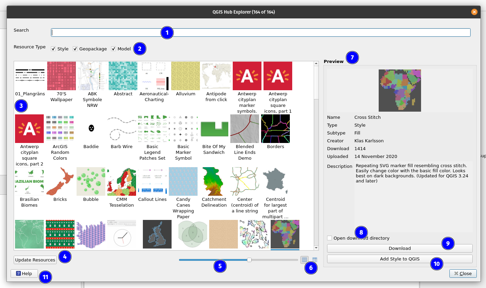

# QGIS Hub Plugin

[](https://plugins.qgis.org/plugins/qgis_hub_plugin/)
[](https://github.com/qgis/QGIS-Hub-Plugin/releases)
[](https://github.com/qgis/QGIS-Hub-Plugin/actions/workflows/tester.yml)
[](https://github.com/qgis/QGIS-Hub-Plugin/actions/workflows/linter.yml)
[](https://qgis.github.io/QGIS-Hub-Plugin/)
[](LICENSE)

Browse the resources shared on the [QGIS Hub](https://hub.qgis.org/) and add them to QGIS in one click, without
leaving QGIS.



## Features

- Browse styles, projects (GeoPackages), processing models and scripts, layer definitions (QLR), 3D models, maps and
  screenshots from the QGIS Hub. New resource types published on the Hub show up automatically.
- Search by name, creator or description, and filter by resource type and subtype.
- Grid view with resizable thumbnails, or list view sortable by name, creator, download count and upload date.
- Preview the selected resource with its description and details.
- Add a resource to QGIS directly:
  - styles are imported into the Style Manager
  - processing models and scripts are added to the Processing Toolbox
  - projects and layer definitions are loaded into QGIS
  - maps open in the web browser
- Or download it to disk, optionally opening the download folder.
- The resource list and thumbnails are cached locally; refresh them from the Hub, or clear the cache in the plugin
  settings.

## Installation

The plugin is published on the QGIS plugins repository: <https://plugins.qgis.org/plugins/qgis_hub_plugin/>.

1. In QGIS, open **Plugins → Manage and Install Plugins…**
1. Search for **QGIS Hub Plugin** and click **Install Plugin**.
1. Open the resource browser from the plugin's toolbar button or from **Plugins → QGIS Hub Plugin**.

Supports QGIS 3.28 and later (Qt5) and QGIS 4 (Qt6).

## Documentation

- User and developer documentation: <https://qgis.github.io/QGIS-Hub-Plugin/>
- Report a bug or request a feature: <https://github.com/qgis/QGIS-Hub-Plugin/issues>
- Changelog: [CHANGELOG.md](CHANGELOG.md)

## Development

```sh
# PyQGIS comes from the system QGIS install, so the venv needs system site packages
python3 -m venv .venv --system-site-packages
source .venv/bin/activate
python -m pip install -U -r requirements/development.txt -r requirements/testing.txt
pre-commit install

# tests
pytest tests/unit/   # without QGIS
pytest tests/qgis/   # with QGIS
```

More in the [development environment setup](docs/development/environment.md), the [testing guide](TESTING_GUIDE.md)
and the [contribution guidelines](CONTRIBUTING.md).

Code is formatted with [Black](https://black.readthedocs.io/en/stable/) and [isort](https://pycqa.github.io/isort/) and
linted with [Flake8](https://flake8.pycqa.org/), through [pre-commit](https://pre-commit.com/) hooks.

GitHub Actions run the tests on QGIS 3 (Qt5) and QGIS 4 (Qt6), lint the code, and build the
[documentation](https://qgis.github.io/QGIS-Hub-Plugin/) with Sphinx from `docs/`. They also run
[Bandit](https://bandit.readthedocs.io/) and QGIS's `pyqt5_to_pyqt6.py` check, the same scans the QGIS plugins
repository runs on upload, where any finding blocks the version.

## Releasing

Pushing a tag triggers the Releaser workflow, which uses [qgis-plugin-ci](https://github.com/opengisch/qgis-plugin-ci/) to
create the GitHub release with the plugin zip and `plugins.xml`, and to upload the zip to the
[QGIS plugins repository](https://plugins.qgis.org/plugins/qgis_hub_plugin/) (with the `QGIS_PLUGIN_TOKEN` repository
secret, a token from the plugin's page on plugins.qgis.org).

1. Open a PR adding the new version to `CHANGELOG.md`, and merge it into `main`:

   ```markdown
   ## X.Y.Z - YYYY-MM-DD

   Added:

   - ...

   Fixed:

   - ...
   ```

   Use plain `Added:` / `Changed:` / `Fixed:` labels, not `###` headings: qgis-plugin-ci ends a version's notes at the
   next `##`, which would leave the release notes and the plugin manager changelog empty.
   No need to edit the version in `metadata.txt`, it is set from the tag.

1. Make sure CI passes on `main`, then tag and push:

   ```sh
   git checkout main && git pull
   git tag -a X.Y.Z -m "Version X.Y.Z"
   git push origin X.Y.Z
   ```

1. Check the Releaser run, the [GitHub release](https://github.com/qgis/QGIS-Hub-Plugin/releases), and the security
   scan of the new version on [plugins.qgis.org](https://plugins.qgis.org/plugins/qgis_hub_plugin/).

Do not create the GitHub release by hand before pushing the tag: the workflow then fails because the release already exists.
A version number can only be uploaded once to plugins.qgis.org, so a blocked or broken upload needs a new patch version.

To check the changelog or build the zip locally:

```sh
python -m pip install -U -r requirements/packaging.txt
qgis-plugin-ci changelog X.Y.Z
qgis-plugin-ci package X.Y.Z --allow-uncommitted-changes
```

## Credits

The idea of the plugin comes from [Tim Sutton](https://github.com/timlinux), at the
[QGIS Contributor Meeting 2023 in 's-Hertogenbosch](https://github.com/qgis/QGIS/wiki/25th-Contributor-Meeting-in-'s-Hertogenbosch).
It is developed by [Ismail Sunni](https://github.com/ismailsunni) and [Ronit Jadhav](https://github.com/ronitjadhav) as
part of [Camptocamp](https://www.camptocamp.com/en)'s open source contributions, with help from
[contributors](https://github.com/qgis/QGIS-Hub-Plugin/graphs/contributors).

## License

Distributed under the terms of the [`GPLv3` license](LICENSE).
